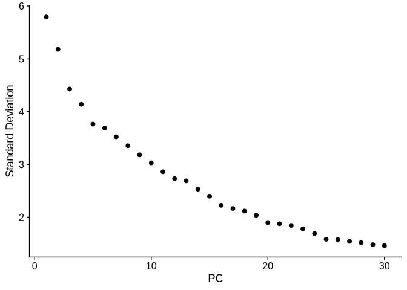
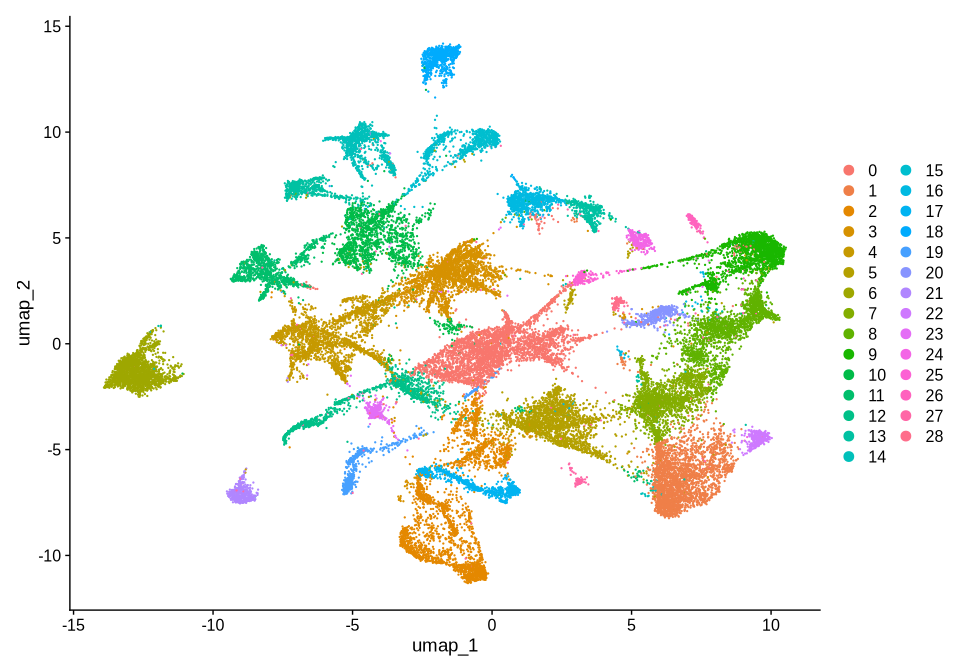
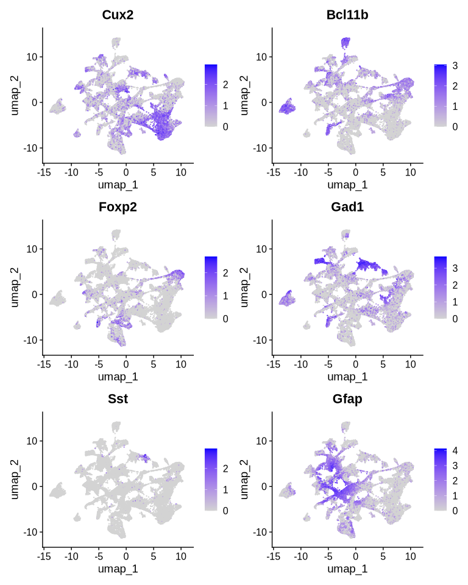
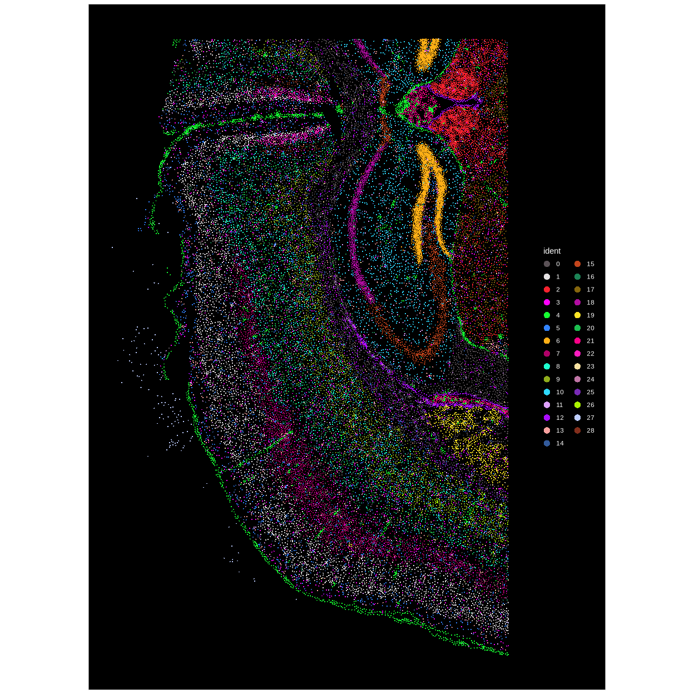
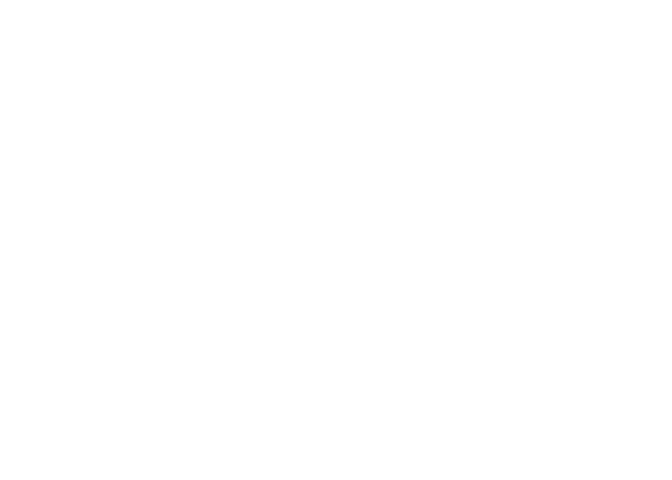

> **Credit:** this notebook is adapted from the Satija Lab Seurat vignette ["Analysis of Image-based Spatial Data in Seurat"](https://satijalab.org/seurat/articles/seurat5_spatial_vignette_2) (Seurat, MIT License), edited for this training course by Min-Yao Jhu.


``` r
library(Seurat)
library(future)
library(ggplot2)
library(tidyverse)  # or just library(dplyr)
set.seed(2)

# 1) Set a larger globals limit BEFORE creating the workers
options(future.globals.maxSize = 4 * 1024^3)  # 4 GiB

# 2) Now create the multisession plan
plan("multisession", workers = 2)
```


``` r
# If a processed Seurat object already exists, load it.
# Otherwise stop and tell the user to run the first Rmd.

saved_path <- "../week3_clustering/xenium_xenium_obj.rds"

if (file.exists(saved_path)) {
  message("Loading existing processed Seurat object...")
  xenium.obj <- readRDS(saved_path)

} else {
  stop(
    "No saved Seurat object found (xenium_xenium_obj.rds).\n",
    "Please run the previous script to generate and save xenium.obj."
  )
}

# Optional sanity check
xenium.obj
```

```
## An object of class Seurat 
## 541 features across 36553 samples within 4 assays 
## Active assay: Xenium (248 features, 0 variable features)
##  1 layer present: counts
##  3 other assays present: BlankCodeword, ControlCodeword, ControlProbe
##  2 spatial fields of view present: fov zoom
```

``` r
Assays(xenium.obj)
```

```
## [1] "Xenium"          "BlankCodeword"   "ControlCodeword" "ControlProbe"
```

``` r
DefaultAssay(xenium.obj)
```

```
## [1] "Xenium"
```


Next, we use SCTransform for normalization followed by standard dimensionality reduction and clustering. This step takes about 5 minutes from start to finish.

### 1) SCTransform(xenium.obj, assay = "Xenium")


``` r
# Temporarily run sequentially to avoid future/globals issues
future::plan("sequential")

# 1) Normalize & model with SCTransform on the Xenium assay
xenium.obj <- SCTransform(xenium.obj, assay = "Xenium")

# Switch back to multisession for later steps if you still want it
future::plan("multisession", workers = 2)
```

What it does:

*Normalizes counts using a regularized negative binomial model (removes depth effects), identifies variable features, and stores transformed data.

*You don’t need NormalizeData() or ScaleData() afterwards—SCTransform() replaces them.

Where it goes:

*By default, it creates an assay named "SCT" (derived from your input assay "Xenium"), sets DefaultAssay(xenium.obj) <- "SCT", and stores:

*SCT@counts (copied or corrected counts),

*SCT@data (Pearson-residual-like normalized values),

*SCT@scale.data (residuals used for PCA),

variable genes in VariableFeatures(xenium.obj).

> Tip: check with Assays(xenium.obj) and DefaultAssay(xenium.obj) right after.


``` r
# sanity checks
Assays(xenium.obj)              # expect "Xenium" and new "SCT"
```

```
## [1] "Xenium"          "BlankCodeword"   "ControlCodeword" "ControlProbe"   
## [5] "SCT"
```

``` r
DefaultAssay(xenium.obj)        # expect "SCT"
```

```
## [1] "SCT"
```

``` r
length(VariableFeatures(xenium.obj))
```

```
## [1] 248
```

### 2) RunPCA(xenium.obj, npcs = 30, features = rownames(xenium.obj))


``` r
# 2) PCA
xenium.obj <- RunPCA(xenium.obj, npcs = 30, features = rownames(xenium.obj))
```


What it does:

*Computes PCA on the (SCT) data.

*features = rownames(xenium.obj) means “use all features of the default assay.” Since SCTransform set the default to SCT, you’re using all SCT features (not just variable ones).

Where it goes:

*Saves a reduction called "pca" in xenium.obj@reductions$pca.

*Loadings and embeddings available via Loadings(xenium.obj, "pca") and Embeddings(xenium.obj, "pca").

> Tip: Usually you’d use only variable features: features = VariableFeatures(xenium.obj) for single cell data. Using all features on a targeted panel is often fine for xenium.


``` r
head(Loadings(xenium.obj, "pca"))    # first rows; one row per gene
```

```
##                       PC_1        PC_2         PC_3         PC_4        PC_5
## 2010300C02Rik -0.053896234  0.05149289  0.011588039 -0.095357507  0.09534982
## Acsbg1         0.006512198 -0.01475413  0.035629778 -0.017482066  0.12485459
## Acta2          0.127721646  0.03474332 -0.001829451  0.006261570 -0.02879866
## Acvrl1         0.107035511  0.04005593  0.155384472  0.050024723 -0.02291227
## Adamts2        0.018174520 -0.02633566 -0.012077898 -0.004128642 -0.01495761
## Adamtsl1       0.020100565 -0.09940292 -0.011765807 -0.005511059 -0.02783930
##                      PC_6         PC_7         PC_8         PC_9         PC_10
## 2010300C02Rik  0.07419982  0.133420360 -0.019631957  0.006591468 -0.0001679998
## Acsbg1        -0.12738695 -0.091226899  0.191489301  0.033721111 -0.0509158109
## Acta2          0.01666064  0.007894234 -0.034704586 -0.093842759 -0.1050939534
## Acvrl1         0.01373046  0.017093772 -0.011247009 -0.004001304  0.0118196573
## Adamts2        0.01394606 -0.003815171 -0.006396516 -0.006185506 -0.0164795593
## Adamtsl1       0.02650528  0.011926803 -0.007572332  0.024331197  0.0548150938
##                       PC_11         PC_12         PC_13        PC_14
## 2010300C02Rik -0.0088377565  0.0367667669 -0.0386379513  0.033059128
## Acsbg1         0.0007508527  0.0132989088  0.0138591710  0.005767932
## Acta2         -0.0681915488  0.2034013237 -0.0660535890 -0.679540095
## Acvrl1         0.0052773043  0.0003066884 -0.0003509106  0.003643485
## Adamts2        0.0224265730 -0.0003352300 -0.0058922445  0.005063069
## Adamtsl1       0.0422383469 -0.0181876072  0.0063809319 -0.008602162
##                      PC_15        PC_16        PC_17       PC_18         PC_19
## 2010300C02Rik  0.037725067  0.014201973  0.049936423 0.003000209  0.0005572753
## Acsbg1        -0.036222424 -0.002779094  0.126265755 0.237722805  0.0463834769
## Acta2          0.280307825  0.015486794  0.071312622 0.034790624 -0.1173458015
## Acvrl1        -0.001032075  0.011147718 -0.002840817 0.011110817 -0.0001116238
## Adamts2        0.010707149  0.008007796  0.012612644 0.012744967  0.0090034355
## Adamtsl1       0.015243655 -0.011128233  0.009539152 0.012882579 -0.0136495930
##                      PC_20         PC_21        PC_22         PC_23       PC_24
## 2010300C02Rik -0.093922319 -0.0058512839 -0.048606170  0.0159006900 -0.02451785
## Acsbg1         0.003375996  0.0788868983 -0.027592170 -0.0351990101 -0.06596360
## Acta2          0.003809455  0.0924875949  0.025925995 -0.2175683313  0.05285759
## Acvrl1        -0.005103835  0.0108292028  0.012506524  0.0380634600  0.01511211
## Adamts2       -0.019892375 -0.0247466583 -0.009439172 -0.0299757042  0.02916715
## Adamtsl1      -0.011905983 -0.0005156244  0.010790171 -0.0006566941 -0.01448733
##                      PC_25        PC_26       PC_27        PC_28       PC_29
## 2010300C02Rik  0.088803192 -0.030547080  0.04935682 -0.001694259  0.03614723
## Acsbg1        -0.056654274 -0.007321824 -0.01374080  0.004868704 -0.00782533
## Acta2          0.064979216 -0.188443125 -0.09605460 -0.059299508  0.02766106
## Acvrl1        -0.003647022 -0.050843837 -0.02577800 -0.014484282  0.00758597
## Adamts2       -0.014170963  0.019804514  0.02778867  0.027143450  0.01158462
## Adamtsl1      -0.012381769  0.029453405  0.00174165  0.006175392 -0.05196703
##                      PC_30
## 2010300C02Rik  0.008747282
## Acsbg1        -0.028330806
## Acta2          0.039633428
## Acvrl1        -0.004318085
## Adamts2        0.014742520
## Adamtsl1       0.021692464
```

``` r
head(Embeddings(xenium.obj, "pca"))  # first rows; the full matrix has one row per cell
```

```
##        PC_1       PC_2        PC_3       PC_4       PC_5        PC_6       PC_7
## 1 -3.952095  2.9110522 -0.83714968 -1.5660357 -1.1256043  3.41041027 -1.9644731
## 2 -3.442478  2.5466690 -0.26083829 -2.3870194 -1.2392603  1.83550450 -2.1746643
## 3  1.588374 -8.6038891 -0.59159181 -0.5108422  0.2148311 -0.08205217 -0.4562878
## 4 -3.312796  1.8582598 -0.36446442 -2.7527080 -2.3016936  2.16384696 -3.6816788
## 5 -3.294512  2.7235161 -1.59971640 -0.2577144 -1.9294694  2.35774792 -1.1215213
## 6 -2.779636  0.5701738  0.04039067 -3.1332481 -1.1393484  2.53870174 -2.8067114
##          PC_8      PC_9      PC_10      PC_11      PC_12      PC_13      PC_14
## 1 -0.29249066 -2.624442  1.1088267  0.5583944 -1.3122813  0.4922089 -0.7847840
## 2  0.67840076 -1.643436  0.4277545  0.5165218 -0.4885371  0.1551636 -0.1602995
## 3  0.45901195 -1.328265 -0.5741703 -0.8829742  2.1296644 -1.9507316  0.5219405
## 4 -0.03636379 -5.134225  3.0845867  0.7812978  1.2568438  0.5256981  1.3043680
## 5 -0.32883752 -3.970153  0.4799717  0.2069958 -0.9539604  0.7833927 -0.7482899
## 6 -1.32470508 -4.705681  3.2982805  1.2892357  1.8188699  1.2347215  0.4169689
##        PC_15      PC_16      PC_17       PC_18      PC_19       PC_20     PC_21
## 1  0.1819991  0.7077548 -1.5280372  0.06569768  0.1066496 -0.32580201 0.4728558
## 2 -0.2108678  1.1836264 -1.2675574 -0.07023303 -0.5331735 -0.84796570 0.4075061
## 3 -2.0981981 -0.3385871 -1.9076958 -4.03873095  1.5977325  1.95594461 1.6229623
## 4 -0.4642436  2.4665229 -0.1585507  1.07017581 -3.3218642  0.08118826 0.4278588
## 5 -0.3055558 -1.2302372 -2.3410408  0.86922303  2.5838018  0.50387694 0.4604130
## 6 -0.6511101  0.6111007  0.5101869  0.94298450 -1.5804702 -0.34462359 0.1348597
##        PC_22       PC_23       PC_24     PC_25        PC_26      PC_27
## 1  1.3331733 -0.69275234  1.30622539 -1.966803  0.257917777 -1.2684155
## 2  1.0745242 -0.31661995  0.14758427 -1.127029  0.006207863 -0.7150980
## 3 -0.4677290 -0.23446679 -1.39462136 -1.426372 -1.689427512  2.8349608
## 4  0.4615181 -0.20194754  0.58494345  1.696074  0.199495141 -0.7892528
## 5  3.2835942 -0.11905811  6.61302554 -4.464292  1.292995282 -1.0715189
## 6 -0.2301034  0.03800553 -0.03749478  1.181302  0.710694834 -0.3829152
##        PC_28       PC_29       PC_30
## 1  0.6711719  0.07044993 -0.26608277
## 2  0.3499817  0.48771105  0.07635315
## 3  0.7349369 -5.98827328 -3.06643270
## 4 -0.3296159 -0.34278920  0.12332841
## 5  2.4553586  2.31281464 -2.01872755
## 6 -0.1499276 -0.39073675 -0.30346260
```


### 3) RunUMAP(xenium.obj, dims = 1:30)


``` r
# 3) UMAP (tune per ElbowPlot)
xenium.obj <- RunUMAP(xenium.obj, dims = 1:30)
```

What it does:

Runs UMAP on the PCA embeddings for PCs 1–30 (the default reduction = "pca").

UMAP is stochastic; set a seed for reproducibility.

Where it goes:

Saves a reduction called "umap" in xenium.obj@reductions$umap.

Coordinates via Embeddings(xenium.obj, "umap").

> Tip: choose the number of PCs with an elbow plot or variance explained, not always “30”.


``` r
# quick diagnostic: how many PCs are useful?
ElbowPlot(xenium.obj, ndims = 30)
```

<!-- -->


### 4) FindNeighbors(xenium.obj, reduction = "pca", dims = 1:30)


``` r
# 4) Neighbours
xenium.obj <- FindNeighbors(xenium.obj, reduction = "pca", dims = 1:30)
```


What it does:

Builds a kNN graph in PCA space (default k = 20).

Computes shared-nearest-neighbour (SNN) graph used by clustering.

Where it goes:

Stores graphs in xenium.obj@graphs, typically names like SCT_nn and SCT_snn (prefix from default assay).


### 5) FindClusters(xenium.obj, resolution = 0.3)


``` r
# 5) Clusters
xenium.obj <- FindClusters(xenium.obj, resolution = 0.3)
```

What it does:

Community detection (Louvain/Leiden) on the SNN graph to assign cluster IDs.

Where it goes:

Sets Idents(xenium.obj) to cluster labels and adds a seurat_clusters column in xenium.obj@meta.data.

> Tip: resolution controls cluster granularity. Try a small grid (e.g., 0.2–1.0) and compare.

We can then visualize the results of the clustering by coloring each cell according to its cluster either in UMAP space with `DimPlot()` or overlaid on the image with `ImageDimPlot()`.


``` r
DimPlot(xenium.obj)
```

<!-- -->

We can visualize the expression level of the markers we looked at earlier on the UMAP coordinates.


``` r
FeaturePlot(xenium.obj, features = c("Cux2", "Bcl11b", "Foxp2", "Gad1", "Sst", "Gfap"))
```

<!-- -->

We can now use `ImageDimPlot()` to color the cell positions colored by the cluster labels determined in the previous step.


``` r
ImageDimPlot(xenium.obj, cols = "polychrome", size = 0.75)
```

<!-- -->

# 6) Find cluster markers (FindAllMarkers)


``` r
#Use SCT assay for differential expression

DefaultAssay(xenium.obj) <- "SCT"

#Find markers for all clusters vs all remaining cells

xenium_markers <- FindAllMarkers(
xenium.obj,
only.pos = TRUE, # only genes up in each cluster
logfc.threshold = 0.25, # minimum log2 fold-change
min.pct = 0.10 # expressed in at least 10% of cells in the cluster
)

#Quick look

head(xenium_markers)
```

<div class="kable-table">

|         | p_val| avg_log2FC| pct.1| pct.2| p_val_adj|cluster |gene     |
|:--------|-----:|----------:|-----:|-----:|---------:|:-------|:--------|
|Sox10    |     0|   4.361392| 0.960| 0.122|         0|0       |Sox10    |
|Opalin   |     0|   5.231929| 0.926| 0.092|         0|0       |Opalin   |
|Gjc3     |     0|   4.004592| 0.999| 0.294|         0|0       |Gjc3     |
|Prox1    |     0|   1.612687| 0.883| 0.285|         0|0       |Prox1    |
|Zfp536   |     0|   2.795555| 0.937| 0.370|         0|0       |Zfp536   |
|Adamtsl1 |     0|   3.936407| 0.632| 0.067|         0|0       |Adamtsl1 |

</div>

``` r
#Optional: save full table

write.csv(
xenium_markers,
file = "xenium_markers_all_clusters.csv",
row.names = FALSE
)
```


``` r
top1_markers <- xenium_markers %>%
  group_by(cluster) %>%
  slice_max(order_by = avg_log2FC,
            n = 1,
            with_ties = FALSE) %>%
  ungroup()

top1_markers
```

<div class="kable-table">

| p_val| avg_log2FC| pct.1| pct.2| p_val_adj|cluster |gene    |
|-----:|----------:|-----:|-----:|---------:|:-------|:-------|
|     0|  5.2319291| 0.926| 0.092|         0|0       |Opalin  |
|     0|  2.8125187| 0.986| 0.342|         0|1       |Lamp5   |
|     0|  5.3934280| 0.263| 0.014|         0|2       |Chat    |
|     0|  4.3842217| 0.976| 0.115|         0|3       |Cldn5   |
|     0|  7.4071080| 0.752| 0.017|         0|4       |Aldh1a2 |
|     0|  2.4147683| 0.679| 0.208|         0|5       |Gli3    |
|     0|  3.8519187| 0.827| 0.127|         0|6       |Slc44a5 |
|     0|  3.2376322| 0.777| 0.141|         0|7       |Rspo1   |
|     0|  2.6114851| 0.339| 0.068|         0|8       |Rxfp1   |
|     0|  3.7247711| 0.901| 0.209|         0|9       |Rprm    |
|     0|  3.9158777| 0.999| 0.419|         0|10      |Cabp7   |
|     0|  5.3759064| 0.885| 0.059|         0|11      |Cd300c2 |
|     0|  5.3824329| 0.377| 0.026|         0|12      |Spag16  |
|     0|  6.2842125| 0.424| 0.017|         0|13      |Sst     |
|     0|  5.5872233| 0.977| 0.098|         0|14      |Gpr17   |
|     0|  3.7618206| 0.584| 0.050|         0|15      |Npy2r   |
|     0|  4.6031789| 1.000| 0.317|         0|16      |Pvalb   |
|     0|  3.9621129| 0.780| 0.131|         0|17      |Calb2   |
|     0|  4.5839657| 0.981| 0.183|         0|18      |Gm2115  |
|     0|  5.2509578| 0.462| 0.029|         0|19      |Nts     |
|     0|  3.6020865| 0.697| 0.073|         0|20      |Gm19410 |
|     0|  5.6321412| 0.996| 0.091|         0|21      |Slc13a4 |
|     0|  2.7131120| 0.915| 0.269|         0|22      |Rnf152  |
|     0|  4.3075349| 0.944| 0.084|         0|23      |Cspg4   |
|     0|  6.7673519| 0.997| 0.084|         0|24      |Vip     |
|     0|  6.0227349| 1.000| 0.110|         0|25      |Cplx3   |
|     0|  5.6449526| 0.982| 0.077|         0|26      |Rxfp1   |
|     0|  0.8719333| 0.771| 0.329|         0|27      |Lypd6   |
|     0|  5.7029472| 0.993| 0.068|         0|28      |Cbln1   |

</div>


``` r
top1_genes <- top1_markers$gene
top1_genes
```

```
##  [1] "Opalin"  "Lamp5"   "Chat"    "Cldn5"   "Aldh1a2" "Gli3"    "Slc44a5"
##  [8] "Rspo1"   "Rxfp1"   "Rprm"    "Cabp7"   "Cd300c2" "Spag16"  "Sst"    
## [15] "Gpr17"   "Npy2r"   "Pvalb"   "Calb2"   "Gm2115"  "Nts"     "Gm19410"
## [22] "Slc13a4" "Rnf152"  "Cspg4"   "Vip"     "Cplx3"   "Rxfp1"   "Lypd6"  
## [29] "Cbln1"
```


``` r
DoHeatmap(
  xenium.obj,
  features = top1_genes,
  group.by = "seurat_clusters" # default when Idents() are clusters
) +
  scale_fill_gradientn(colours = c("navy", "white", "red")) +
  theme(axis.text.y = element_text(size = 8))
```

<!-- -->


<details>

<summary>**Session Info**</summary>


``` r
sessionInfo()
```

```
## R version 4.4.3 (2025-02-28)
## Platform: x86_64-conda-linux-gnu
## Running under: Ubuntu 26.04.1 LTS
## 
## Matrix products: default
## BLAS/LAPACK: <conda env>/lib/libopenblasp-r0.3.34.so;  LAPACK version 3.12.0
## 
## locale:
##  [1] LC_CTYPE=C.UTF-8       LC_NUMERIC=C           LC_TIME=C.UTF-8       
##  [4] LC_COLLATE=C.UTF-8     LC_MONETARY=C.UTF-8    LC_MESSAGES=C.UTF-8   
##  [7] LC_PAPER=C.UTF-8       LC_NAME=C              LC_ADDRESS=C          
## [10] LC_TELEPHONE=C         LC_MEASUREMENT=C.UTF-8 LC_IDENTIFICATION=C   
## 
## time zone: America/Chicago
## tzcode source: system (glibc)
## 
## attached base packages:
## [1] stats     graphics  grDevices utils     datasets  methods   base     
## 
## other attached packages:
##  [1] lubridate_1.9.5    forcats_1.0.1      stringr_1.6.0      dplyr_1.2.1       
##  [5] purrr_1.2.2        readr_2.2.0        tidyr_1.3.2        tibble_3.3.1      
##  [9] tidyverse_2.0.0    ggplot2_4.0.3      future_1.82.0      Seurat_5.5.1      
## [13] SeuratObject_5.4.0 sp_2.2-3          
## 
## loaded via a namespace (and not attached):
##   [1] RColorBrewer_1.1-3          jsonlite_2.0.0             
##   [3] magrittr_2.0.5              spatstat.utils_3.2-5       
##   [5] farver_2.1.2                rmarkdown_2.32             
##   [7] zlibbioc_1.52.0             vctrs_0.7.3                
##   [9] ROCR_1.0-12                 DelayedMatrixStats_1.28.0  
##  [11] spatstat.explore_3.8-2      S4Arrays_1.6.0             
##  [13] htmltools_0.5.9             SparseArray_1.6.0          
##  [15] sass_0.4.10                 sctransform_0.4.3          
##  [17] parallelly_1.50.0           KernSmooth_2.23-27         
##  [19] bslib_0.12.0                htmlwidgets_1.6.4          
##  [21] ica_1.0-3                   plyr_1.8.9                 
##  [23] plotly_4.12.1               zoo_1.9-0                  
##  [25] cachem_1.1.0                igraph_2.3.4               
##  [27] mime_0.13                   lifecycle_1.0.5            
##  [29] pkgconfig_2.0.3             Matrix_1.7-6               
##  [31] R6_2.6.1                    fastmap_1.2.0              
##  [33] GenomeInfoDbData_1.2.13     MatrixGenerics_1.18.0      
##  [35] fitdistrplus_1.2-6          shiny_1.14.0               
##  [37] digest_0.6.39               patchwork_1.3.2            
##  [39] S4Vectors_0.44.0            tensor_1.5.1               
##  [41] RSpectra_0.16-2             irlba_2.4.1                
##  [43] GenomicRanges_1.58.0        labeling_0.4.3             
##  [45] progressr_1.1.0             spatstat.sparse_3.2-0      
##  [47] timechange_0.4.0            httr_1.4.9                 
##  [49] polyclip_1.10-7             abind_1.4-8                
##  [51] compiler_4.4.3              withr_3.0.3                
##  [53] S7_0.2.2                    fastDummies_1.7.6          
##  [55] MASS_7.3-66                 DelayedArray_0.32.0        
##  [57] tools_4.4.3                 lmtest_0.9-40              
##  [59] otel_0.2.0                  httpuv_1.6.17              
##  [61] future.apply_1.21.0         goftest_1.2-3              
##  [63] glmGamPoi_1.18.0            glue_1.8.1                 
##  [65] nlme_3.1-170                promises_1.5.0             
##  [67] grid_4.4.3                  Rtsne_0.17                 
##  [69] cluster_2.1.8.3             reshape2_1.4.5             
##  [71] generics_0.1.4              gtable_0.3.6               
##  [73] spatstat.data_3.1-9         tzdb_0.5.0                 
##  [75] data.table_1.18.6.1         hms_1.1.4                  
##  [77] XVector_0.46.0              BiocGenerics_0.52.0        
##  [79] spatstat.geom_3.8-2         RcppAnnoy_0.0.23           
##  [81] ggrepel_0.9.8               RANN_2.6.2                 
##  [83] pillar_1.11.1               spam_2.11-4                
##  [85] RcppHNSW_0.7.0              later_1.4.8                
##  [87] splines_4.4.3               lattice_0.23-1             
##  [89] survival_3.8-12             deldir_2.0-4               
##  [91] tidyselect_1.2.1            miniUI_0.1.2               
##  [93] pbapply_1.7-4               knitr_1.52                 
##  [95] gridExtra_2.3.1             IRanges_2.40.0             
##  [97] SummarizedExperiment_1.36.0 scattermore_1.2            
##  [99] stats4_4.4.3                xfun_0.61                  
## [101] Biobase_2.66.0              matrixStats_1.5.0          
## [103] UCSC.utils_1.2.0            stringi_1.8.9              
## [105] yaml_2.3.12                 evaluate_1.0.5             
## [107] codetools_0.2-20            cli_3.6.6                  
## [109] uwot_0.2.5                  xtable_1.8-8               
## [111] reticulate_1.47.0           jquerylib_0.1.4            
## [113] GenomeInfoDb_1.42.0         Rcpp_1.1.2                 
## [115] globals_0.20.0              spatstat.random_3.5-1      
## [117] png_0.1-9                   spatstat.univar_3.2-0      
## [119] parallel_4.4.3              dotCall64_1.2              
## [121] sparseMatrixStats_1.18.0    listenv_1.1.0              
## [123] viridisLite_0.4.3           scales_1.4.0               
## [125] ggridges_0.5.7              crayon_1.5.3               
## [127] rlang_1.3.0                 cowplot_1.2.0
```

</details>


